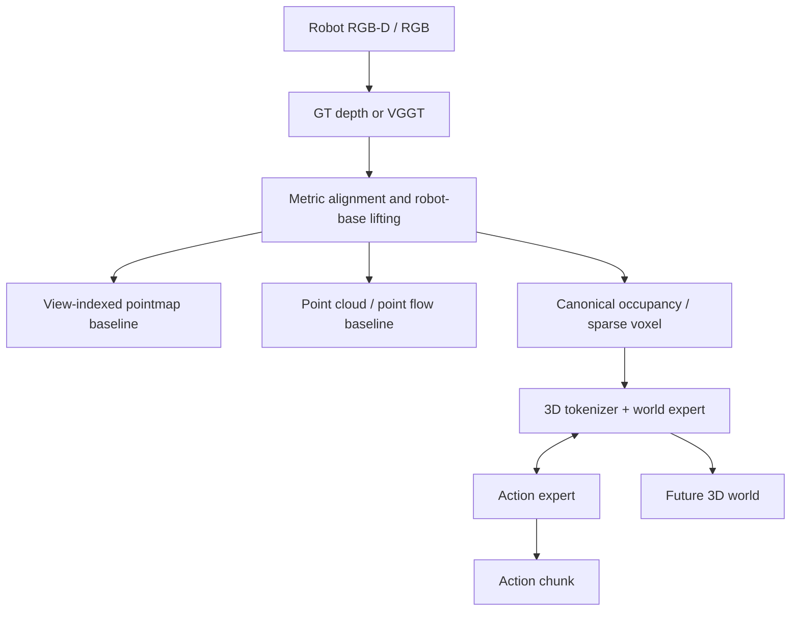
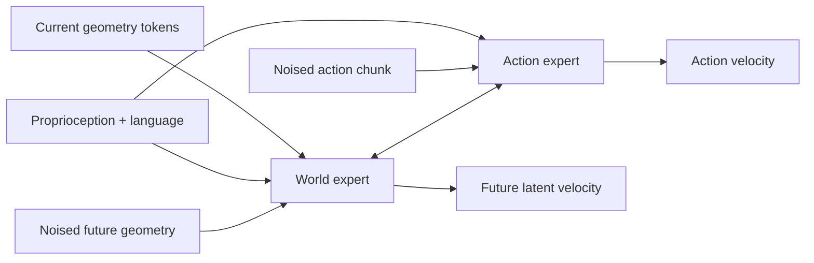

# Candidate A — 3D-Native Generative World-Action Model

> 内部研究 / PoC 计划（v0.1，2026-11-18）  
> 暂定代号：CV-WAM（Canonical Volumetric WAM，仅内部使用，正式命名前查重）  
> 目标：独立一作机器人学习会议论文；优先验证模型机制，而非单独发布几何分析或 benchmark。

## 0. 给服务器 Coding Agent 的执行说明

本文件是研究规格与分阶段执行计划，不是已实现的代码仓库。首先执行 **Stage 0、Stage 1、Stage 2**，输出实际测量结果；通过验收后再执行 `Stage 3` 的小型生成模型。不要自动下载多个大型数据集、启动 5B/6B WAM 训练、占用多卡或覆盖已有环境。

- 优先复用服务器现有的 RoboTwin 2.0、Flex-π / OpenWAM / SeGo-WAM 数据处理与 policy 接口；先检查代码与数据实际可访问性、授权及版本。
- 已有 CVPR 匿名稿及实验代码属于内部材料：不上传至公开仓库，不将未发表结果当作公开 baseline，后续独立研究需明确贡献归属与复用权限。
- Candidate B（Test-Time Physical Learning）与 Candidate C（Differential WAM）均为独立项目。本计划不引入 TTT、物理参数记忆、动作响应 Jacobian 或 DreamGate。
- 新建隔离目录和环境，所有原始数据只读；不改动现有训练仓库和 benchmark 默认配置。
- 标注为 `待实现` 的脚本名、CLI 和 YAML 是接口规范，不是现成工具。先检查实际 repo API，再实现适配层；不要凭空假定 HDF5 key、数据目录、关节顺序、相机参数格式或 simulator method。
- 每个阶段写 `report.md`、配置、命令、耗时、显存、失败案例与原始指标；失败也保留。没有实际执行的数据一律标为 `NOT_RUN`。

### 本轮最小交付（第一批服务器测试）

1. GPU / 环境 / 数据结构盘点。
2. 1 个 RoboTwin 任务、3–5 条 episode 的同步多视角 RGB-D 数据导出。
3. 同帧 GT-depth 点云、VGGT 点云及 canonical voxel 的可视化与误差报告。
4. 三视角融合、相机坐标变换、时间稳定性、体素化与稀疏率测试。
5. 如果前四项通过：用少量 episode 训练小型未来 occupancy/point-flow predictor，确认不是仅复制当前帧。

**第一批测试不以 benchmark 成功率或 SOTA 为目标。** 一次服务器 smoke test 只证明管线可运行，不能证明论文假设成立。

---

## 1. Research question & scope

### 1.1 核心研究问题

> Can a world-action model generate future physical space in a canonical 3D representation, instead of forecasting a set of camera-dependent images or pointmaps, while improving robotic manipulation under viewpoint shift and occlusion?

现有 video WAM 常以相机视角为索引预测未来。即使预测 RGB、depth 或 pointmap，它们通常仍保留二维像素网格与相机索引。机器人头部和腕部相机实际观察的是同一个三维世界；腕部相机运动还会引入与物体动力学无关的画面变化。

候选 A 的中心假设：在 robot-base frame 中维护统一世界状态，通过原生三维 latent 生成未来，并将未来几何用于 action generation，可降低相机依赖，并使跨视角、遮挡与空间布局变化下的控制更可靠。

### 1.2 当前主张与边界

- `VGGT → 3D reconstruction → WAM` 只是技术路线，不足以成为论文贡献。
- `Point Cloud → Voxel` 是可比较的表示选择，不是创新本身。
- `Joint Flow Matching` 是 baseline 生成机制，不应单独声称为新方法。
- 不以“首个 3D WAM”“首个 Occupancy WAM”“首个 VGGT WAM”为主张。
- 优先探索 **可见性约束的 canonical volumetric generation**：区分已观测自由空间、已观测表面与未观测空间；让模型预测未知区域的 occupancy 分布并形成可被 action expert 使用的结构，而非仅作辅助重建。
- 如果体素没有表现出可归因的优势，允许改为点云/点轨迹或三维对齐 latent；若主假设不成立则停止该候选，而不是堆模块。

### 1.3 假设（均未验证）

| ID | 假设 | 可证伪观察 |
|---|---|---|
| H1 | Canonical 3D 表示比 view-indexed 表示更具视角鲁棒性 | GT 几何下仍没有视角 OOD 改善 |
| H2 | 原生三维未来预测有助于控制，而不仅是额外监督 | 同容量 current-only policy 或 auxiliary-only WAM 达到相同控制能力 |
| H3 | 体素自由空间/未知空间结构比只跟踪已观察点更有利于遮挡任务 | 相同信息与预算下 point-flow policy 获得相同或更好表现 |
| H4 | VGGT 可作为 RGB-only 的可用几何输入 | 对齐后误差仍超过接触精度，且明显影响 rollout |

H4 失败不必立即否定 H1–H3：可先采用 RGB-D 部署。H1–H3 若均无支持，则停止该方向。

---

## 2. Related work & novelty audit

以下为 2026-11-18 已核对的主要公开来源；摘要/项目页核对不等于逐式查重，正式立项前需打开全文与代码确认。每篇补充 `what is generated / input / action interface / coordinate frame / novelty / code availability`。

| 论文 | 已覆盖能力 | 本项目必须区分的内容 |
|---|---|---|
| [VGGT](https://github.com/facebookresearch/vggt) / [权重](https://huggingface.co/facebook/VGGT-1B) | 多视角几何重建、深度、相机参数与 pointmap | 重建不是未来动力学；度量尺度与 robot-base 对齐需验证 |
| [VGGT-World](https://arxiv.org/abs/2603.12655) | 冻结 VGGT 特征、未来 latent 生成；z-prediction 与 latent flow forcing | 预测几何 latent 已有先例；机器人联合控制与显式三维空间约束需有独立机制 |
| [PointWAM](https://arxiv.org/abs/2610.02840) | 共享三维坐标的场景/手部点轨迹联合预测、动作重定向 | 新增可见范围之外的空间假设、自由空间/占据拓扑与直接控制；不能只改点云编码器 |
| [PointWorld](https://arxiv.org/abs/2601.03782) / [代码](https://github.com/NVlabs/PointWorld) / [权重](https://huggingface.co/nvidia/PointWorld_models) | 预训练 action-conditioned 3D point-flow dynamics | 可作 forward dynamics 参考；不能直接当成 joint FM checkpoint |
| [OccWAM](https://arxiv.org/abs/2610.17688) | 自动驾驶 occupancy 和 ego trajectory 联合 FM；scene-to-ego refinement | 不能仅迁移自动驾驶 occupancy joint flow；强调操作任务的遮挡、可见性与接触尺度 |
| [Hybrid Particle-Voxel Dynamics](https://arxiv.org/abs/2611.04492) / [主页](https://jwang771.github.io/3dworldsimulator/) | 点云→压缩体素 latent，action-conditioned 3D dynamics，多模态模拟 | 直接动作策略 + 可见性结构参与生成与控制；不能只使用 particle-voxel AE |
| [Flex-π](https://arxiv.org/abs/2608.10860) | 冻结 video VAE 编码 XYZ pointmap，在 MoT 中联合生成 | view-indexed pointmap 是重要 baseline，而不是待声称的新贡献 |
| [MVG-WAM](https://arxiv.org/abs/2609.37793) | 多视角几何约束、共享全局状态与 view-indexed states | 单纯多视角融合/共享世界 state 已有工作；需证明原生三维生成与可见性机制 |
| [WSA1](https://arxiv.org/abs/2607.03941) | 3D-centric world/spatial/action 联合建模 | 泛泛的三维 world-action 联合学习不能构成独创性 |
| [ORV](https://arxiv.org/abs/2506.03079) | 操作数据的 4D occupancy 表达与视频生成 | 原生 occupancy 作为生成目标、用于直接动作策略 |
| [OccSora](https://arxiv.org/abs/2405.20337) | 自动驾驶 4D occupancy tokenizer / generator | 借鉴压缩与生成方法，不声称首次 4D occupancy |

### 提交前必须回答的撞题问题

- PointWAM、MVG-WAM、WSA1 是否已经显式建模 unknown/free occupancy，并联合生成这些信息？
- Particle-Voxel Dynamics 是否已直接训练 action policy、处理未知空间后验并使用它生成动作？
- 检索 perception-aware planning、amodal occupancy forecasting、scene completion、belief-space planning、diffusion 3D policy 等非 WAM 文献：是否已存在同样的可见性条件生成机制？
- 若最接近工作仅相差数据格式、任务类别、编码器或一个 loss，则不进入大规模训练。

建议保存 `research/novelty_matrix.md` 与论文版本号，之后定期检查新 preprint。

---

## 3. Architecture options

### 3.1 不提前锁定表示



| 表示 | 数据结构 | 优势 | 风险 |
|---|---|---|---|
| Pointmap | `[V,H,W,3]` | 可沿用 video VAE 和 MoT，强对照 | 仍与相机视角网格绑定 |
| Point cloud | `[N,3+C]` | 高分辨率、稀疏 | 动态点对应、未观测空间、采样密度问题 |
| Voxel | `[X,Y,Z,C]` | 固定度量索引、free/occupied/unknown、生成新占据 | 分辨率与计算成本 |
| 3D lifted VGGT feature | `[N,D]` 或 voxel features | 继承几何表征 | 特征层/对齐/压缩、预训练时序能力缺失 |

**实验默认选择：先用 GT depth 建立点云与体素，再用 VGGT 替换几何来源。** 不强制所有版本依赖 VGGT；其收益不能与 canonical 表示本身混淆。

### 3.2 主候选：Visibility-Aware Canonical Voxel WAM

观察状态：`O_t = {rgb_t, depth_t?, K_t, T_base_cam_t, q_t, language}`。

利用标定及 RGB-D 建立当前三维状态 `X_t`，包含：

- `surface_hit`：观测到的占据表面（不是物体完整内部）；
- `free`：相机有效视线到达表面之前的已观测自由空间；
- `unknown`：没有足够观测证据的空间；
- `confidence` / `view_count`：观测可靠性；
- `semantic_feature`（可选、初期关闭）：DINO/VGGT 特征投影到体素。

真实占据 `Y_t` 与观察 mask `M_t` 分开存储。是否可见并不等于是否占据，注意 future mask 变化也可能仅来自相机运动。

最终模型学习 `p(Y_future, A | X_current, M_current, q_current, language)`；生成未来物理占据分布，而不是把 `unknown` 当成真实第三种物质。多视角表面观察只能监督已观测部分；若有 simulator mesh/occupancy GT，才采用完整空间监督。

### 3.3 候选机制（Stage 4 以后才实现）

在固定 canonical latent 网格中区分当前已观察信息和未观察区域；world expert 预测未来 occupancies 与其不确定性，action expert 读取预测的空间状态/置信信息。比较：

- `V0`：普通 voxel WAM，不使用可见性信息，仅做合法的 occupancy masked supervision；
- `V1`：当前 visibility 作为普通输入；
- `V2`：visibility-structured world attention / conditioning，在未来生成中分离已观测证据与未观测空间假设，再将预测的空间概率分布提供给 action expert；
- `V2-aux`：与 V2 同样的世界监督，但未来 token 不可直接参与动作生成。

V2 具体 attention 机制目前为研究设计而非已证明算法，必须与 V1 使用相同参数预算、相同几何输入和相同监督，排除仅增加输入信息或模型容量带来的收益。

注意：不能把当前 occupied/free 区域在所有未来时间硬性锁定（物体会移动）；只锁定当前条件 token，未来动态 occupancy 由模型预测。不能将 oracle future visibility、未来深度、目标动作或完美 mesh 状态作为测试条件。

---

## 4. Repo / environment layout

建议独立目录：

```text
candidate_a/
├── plan.md
├── configs/
│   ├── smoke.yaml
│   ├── tiny_predictor.yaml
│   └── ablation.yaml
├── third_party/              # git clone / symlink，记录 commit
├── src/
│   ├── adapters/robotwin.py
│   ├── geometry/{camera.py,alignment.py,voxel.py}
│   ├── models/{point.py,voxel.py,flow.py,action.py}
│   └── evaluation/
├── scripts/
│   ├── inspect_env.sh
│   ├── inspect_dataset.py
│   ├── export_frames.py
│   ├── smoke_vggt.py
│   ├── build_geometry.py
│   ├── eval_geometry.py
│   ├── train_tokenizer.py
│   ├── train_tiny.py
│   └── eval_policy.py
├── tests/
├── research/novelty_matrix.md
├── data/                     # manifest / cache, 原始数据使用 symlink
└── runs/                     # 日期/实验 ID，禁止覆盖
```

以上为待实现结构。已有仓库如包含功能相同的实现，应复用而不是重复开发。

### 4.1 Stage 0 — 系统盘点

```bash
pwd
whoami
nvidia-smi
nvidia-smi --query-gpu=name,memory.total,memory.free,driver_version --format=csv
python --version
which python
df -h .
command -v conda || true
python - <<'PY'
import torch
print('torch:', torch.__version__)
print('CUDA build:', torch.version.cuda)
print('CUDA available:', torch.cuda.is_available())
if torch.cuda.is_available():
    print('GPU count:', torch.cuda.device_count())
    print('GPU:', torch.cuda.get_device_name(0))
    print('BF16:', torch.cuda.is_bf16_supported())
PY
```

对于已有 RoboTwin/WAM repo：

```bash
git -C "$ROBOTWIN_ROOT" rev-parse HEAD
git -C "$ROBOTWIN_ROOT" status --short
# WAM_ROOT 为实际授权访问的仓库路径
git -C "$WAM_ROOT" rev-parse HEAD
```

`ROBOTWIN_ROOT`、`WAM_ROOT`、`DATA_ROOT` 由服务器实际配置确定。未提供路径先搜索允许的工作目录/已有配置，不全盘扫描其他用户目录。

建议复用已有 PyTorch CUDA 环境并创建独立 VGGT 环境；不要为安装 VGGT 在 RoboTwin 工作环境中升级 torch。若为 Slurm 集群，在分配到 GPU 后执行推理，单卡测试即可。无 CUDA 或资源不足时先做 GT 几何的 CPU 单测。

记录：GPU 型号和可用显存、驱动、Python/PyTorch/CUDA、磁盘、repo commit、模型权重可达性、可用数据与授权。首次仅下载 VGGT-1B；其他 ckpt 先不下载。

---

## 5. Stage 1 — RoboTwin data + geometry ground truth (P0)

### 5.1 最小数据规模

- Smoke：任选 1 个已有任务（优先 `Stack Blocks Two` / 或 `Pick Dual Bottles`，实际 task ID 从 repo 枚举），3–5 个已录制 episode，每个抽取 3–5 个时刻。
- PoC：在同一几何流程稳定后扩展到两个任务，每个约 30–50 个 episode，按 episode 划分训练/验证/测试；数据不足时先用少量 episode overfit。
- 使用同一时刻的 head、left wrist、right wrist；禁止把不同时间的动态帧当作静态多视图一起重建。
- 不要一开始重新生成完整 RoboTwin-Full；不要默认读取未来 observation 作为当前输入。

### 5.2 检查原始数据

首先用已有 WAM loader 或 h5py/数据集实际 API 检查 sample keys、shape、dtype、时间轴与压缩。以下仅为 HDF5 情况的工具：

```bash
python - /path/to/one_episode.hdf5 <<'PY'
import sys, h5py
with h5py.File(sys.argv[1], 'r') as f:
    def visit(name, obj):
        if isinstance(obj, h5py.Dataset):
            print(name, obj.shape, obj.dtype)
    f.visititems(visit)
PY
```

如数据集没有深度或相机标定，先检查现有 simulator observation / dataset export 接口。必要时用少量重新采集的轨迹；若只有 RGB 且无 metric scale 锚点，则 GT 误差实验标记 unavailable，不伪造真值。

### 5.3 Canonical sample contract

建议每个 sample 或 episode 至少包含（统一后的字段，不代表原始字段名）：

```python
sample = {
    'episode_id': str,
    'task_id': str,
    't': int,
    'timestamps': ...,             # 对齐后的 state times
    'rgb': ...,                    # [V,H,W,3] uint8 RGB, 单帧
    'depth_m': ...,                # [V,H,W] float32: optical-axis Z, meters
    'depth_valid': ...,            # [V,H,W] bool
    'K': ...,                      # [V,3,3], 对应实际图像分辨率
    'T_base_cam': ...,             # [V,4,4], base_from_camera, OpenCV axes
    'qpos': ...,                   # 真实 robot state, 明确关节顺序
    'action': ...,                 # [H_a,D_a], 与 policy 接口一致
    'action_valid': ...,           # [H_a] bool，排除 padding
    'language': str,
}
```

- 不假定原始 depth 的单位是 mm 或 m：检查 dtype、范围和已知桌面距离；无效值/NaN 先过滤。
- 相机内参必须与 resize/crop 后的图像一致；裁剪和平移均要更新 principal point。
- 判断 simulator depth 为 z-depth 还是 ray distance，若为后者应先换算。
- 确认 camera convention：OpenCV +x 右、+y 下、+z 前；若原外参是 OpenGL/仿真坐标，做显式转换并保存。
- wrist extrinsics 是逐时刻的，不能固定为 episode 首帧的参数。
- action 必须确认是绝对 joint target、增量、EE pose 或其他格式。优先沿用现有双臂 policy 的接口，实际维度从数据读取。

### 5.4 GT depth unprojection

对于像素 `(u,v)` 及光轴深度 `d`：

```text
p_cam  = d * inv(K) @ [u,v,1]
p_base = R_base_cam @ p_cam + t_base_cam
```

最小 NumPy 参考实现（单视角）：

```python
import numpy as np

def depth_to_base(depth_m, K, T_base_cam, valid=None):
    h, w = depth_m.shape
    v, u = np.indices((h, w), dtype=np.float32)
    mask = np.isfinite(depth_m) & (depth_m > 0)
    if valid is not None:
        mask &= valid.astype(bool)
    uv1 = np.stack([u[mask], v[mask], np.ones(mask.sum())], axis=1)
    p_cam = (uv1 @ np.linalg.inv(K).T) * depth_m[mask, None]
    p_base = p_cam @ T_base_cam[:3, :3].T + T_base_cam[:3, 3]
    return p_base.astype(np.float32), mask
```

先用已知 3D 点做投影→反投影单测（含非单位旋转、平移），再检查真实桌面、已知机械臂位置和不同视角 overlap。不能只看点云整体好看。

输出每个视角单独 PLY、融合 PLY、相机中心/坐标轴、点数、视角覆盖统计及固定 workspace bbox 内比例；保留从 voxel 回溯到原始 view 的索引/置信度。

### Gate G1

- 多视角几何在 base frame 中一致且方向/尺度正确；
- 对合成投影/反投影单测误差低于 `1e-5 m`（浮点数值误差级）；
- 时序、动作、相机参数对齐；不存在可见的旋转 180°、毫米/米混淆或腕部相机漂移；
- 任何一项失败先修 data/camera adapter，不启动训练。

---

## 6. Stage 2 — VGGT reconstruction smoke test (P0)

### 6.1 安装与官方入口

参考官方 [VGGT README](https://github.com/facebookresearch/vggt/blob/main/README.md)。先用原版 VGGT-1B（官方文档完整）跑通，后续再升级 VGGT-Ω，禁止为了新版本阻塞基础测试。

```bash
mkdir -p third_party
cd third_party
git clone https://github.com/facebookresearch/vggt.git
cd vggt
# 在独立、已验证 torch/CUDA 环境中执行；记录依赖变更
python -m pip install -r requirements.txt
# 若依赖冲突：先检查 requirements，保留当前可用 GPU torch 版本
```

官方权重首次运行可能联网下载。服务器没外网时，通过允许的镜像/离线方式准备权重和依赖；不要把下载失败当作算法失败。

### 6.2 单帧三视角 smoke script

将以下保存为 `scripts/smoke_vggt.py`，从 VGGT repo 根目录运行（或按其安装方式加入 Python 路径）。CPU 不是本试验预期路径。代码根据官方 demo 的 API 编写，**尚未在用户服务器执行**，以实际 checkout 的 shape 为准。

```python
import argparse
import json
import time
from pathlib import Path
import numpy as np
import torch
from vggt.models.vggt import VGGT
from vggt.utils.load_fn import load_and_preprocess_images
from vggt.utils.pose_enc import pose_encoding_to_extri_intri
from vggt.utils.geometry import unproject_depth_map_to_point_map

p = argparse.ArgumentParser()
p.add_argument('--images', nargs='+', required=True)
p.add_argument('--out', required=True)
args = p.parse_args()
out = Path(args.out)
out.mkdir(parents=True, exist_ok=True)
assert torch.cuda.is_available(), 'Allocate a CUDA GPU first.'
device = 'cuda'
dtype = torch.bfloat16 if torch.cuda.is_bf16_supported() else torch.float16
model = VGGT.from_pretrained('facebook/VGGT-1B').eval().to(device)
images = load_and_preprocess_images(args.images).to(device)
print('images:', images.shape, images.dtype)
torch.cuda.synchronize()
torch.cuda.reset_peak_memory_stats()
t0 = time.perf_counter()
with torch.inference_mode(), torch.autocast('cuda', dtype=dtype):
    pred = model(images)
    ext, K = pose_encoding_to_extri_intri(pred['pose_enc'], images.shape[-2:])
torch.cuda.synchronize()
latency = time.perf_counter() - t0

def as_np(x):
    return x.detach().float().cpu().numpy()

depth = as_np(pred['depth']).squeeze(0)
dconf = as_np(pred['depth_conf']).squeeze(0)
extrinsic = as_np(ext).squeeze(0)  # camera_from_VGGT_world (OpenCV)
intrinsic = as_np(K).squeeze(0)
points = np.asarray(unproject_depth_map_to_point_map(depth, extrinsic, intrinsic))
np.savez_compressed(out/'geometry.npz', depth=depth, depth_conf=dconf,
                    extrinsic=extrinsic, intrinsic=intrinsic, points=points,
                    images=as_np(images))
meta = dict(images=args.images, image_shape=list(images.shape),
            depth_shape=list(depth.shape), points_shape=list(points.shape),
            peak_allocated_gib=torch.cuda.max_memory_allocated()/1024**3,
            inference_s=latency,
            finite_points=int(np.isfinite(points).all(-1).sum()))
(out/'meta.json').write_text(json.dumps(meta, indent=2))
print(meta)
```

运行示例（路径替换为实际导出的同步帧）：

```bash
# 在已分配 GPU 的 shell 中；CUDA_VISIBLE_DEVICES 遵循集群分配
python /path/to/candidate_a/scripts/smoke_vggt.py \
  --images /path/to/head.png /path/to/left_wrist.png /path/to/right_wrist.png \
  --out /path/to/candidate_a/runs/vggt_smoke/frame_0000
```

如果直接脚本运行找不到 `vggt`，按照官方包安装说明安装该 checkout，或显式设置 `PYTHONPATH`。检查输出 shape 与官方 demo，若需要对 batch 轴做调整应显式 assert 而非任意 squeeze。脚本只保存原始几何；PLY 融合、置信过滤和尺度对齐下一步完成。

### 6.3 四个重建模式

| ID | 输入 | 用途 |
|---|---|---|
| G0 | GT depth + GT camera | 上界/几何基准 |
| G1 | VGGT 单个 head view | 单图鲁棒性；它不提供独立 metric scale |
| G2 | VGGT head + two wrist（同步） | 多视角增益与重叠失败测试 |
| G3 | VGGT estimated depth + 已知标定外参/内参（按实际预处理适配） | 区分深度误差和相机估计误差 |

额外比较 VGGT point head 和 depth-unprojection 路线（官方 README 推荐后者常有更好重建精度）。不要将原版 VGGT confidence 值当成已校准概率；报告分位数过滤及覆盖变化，例如保留 50%、75%、90% 的有效点。

### 6.4 尺度与坐标对齐

VGGT world 坐标并不是 robot-base world；不能简单拼接每帧输出。先明确 VGGT extrinsic 是 camera-from-world，再逆变换得到 camera centers。使用可用的独立尺度/位姿锚点建立：

```text
p_base = s * R * p_vggt + t
```

两类实验严格区分：

- **Oracle diagnostic**：利用同步 GT 深度/已知点对应进行 Umeyama Sim(3) 对齐，只用于定量诊断，不能当作 RGB-only 部署成绩；
- **Deployable alignment**：使用已知相机标定、相机中心 baseline、机器人 FK 或已知尺寸/尺度锚点；不得使用未来帧及测试 GT depth。如果少视图相机中心退化或腕部几何不稳定，记录失败而不硬拟合。

对 G3 可将 VGGT 相对深度缩放到由部署可用锚点确定的度量尺度，再使用匹配当前像素分辨率的 GT/标定 K/T 反投影。每帧独立尺度拟合的漂移也要计入评测。

### 6.5 测量指标

- GT 对应的深度误差：MAE / RMSE (m)、abs-rel、有效覆盖率；仅在对应有效像素计算。
- 点云：双向 nearest-neighbor 距离（分别报告 accuracy/completeness，单位 mm）、固定阈值 F-score、workspace coverage。
- 多视角：重投影误差（pixel）、重叠区域点距；不能将不重叠点集直接计算 correspondence error。
- 相机姿态：旋转误差（deg）、平移误差（m）；记录 alignment 模式。
- 时间稳定性：在稳定桌面或静态背景 mask 中，连续帧对齐后点云漂移；单独分析腕部运动、遮挡、反光物体失败。
- 资源：1/2/3 view latency、模型加载与 steady-state 分开、peak GPU allocated/reserved memory；warmup 后计时，避免 CUDA 异步误差。

建议保存 `geometry_metrics.csv` 与固定视角截图，显示 G0/G1/G2/G3 并排点云，而非只显示一张最好的结果。

### Gate G2（暂定工程阈值，需按真实 workspace 与任务调整）

- VGGT 推理能输出有限点、可对齐点云、可复现日志；
- 观察重叠区域的重建误差、静态漂移与局部任务所需精度的关系（初始关注 10–20 mm、接触任务更严格）；
- 若 median 对齐误差超过 1–2 个目标 voxel 或任务容差，RGB-only 暂缓，继续 GT/RGB-D 路径；不能使用 oracle 对齐掩盖部署误差。
- 即使 VGGT 多视图重建不理想，GT 路线仍可用于模型 PoC；若 GT 路线也失败则停止并修管线。

---
## 7. Stage 2b — Canonical point cloud and voxel cache (P0)

### 7.1 Point cloud baseline

For each time index, transform all valid points into the same robot-base frame, then concatenate and crop to a fixed metric workspace. Retain confidence and view ID. Use voxel downsampling or deterministic farthest-point sampling for a bounded point budget (start with 2,048 or 4,096 points). Do not normalize each cloud independently to its own bounding box; that would remove metric motion and introduce coordinate inconsistency. Fit any global normalization on train episodes only.

- Maintain separate caches for GT geometry and VGGT geometry; use identical crop and output conventions.
- Exclude background outside workspace; do not remove manipulated objects or the gripper without a separate ablation.
- Point-flow targets require actual point correspondences: use simulator object pose + rigid-body attachment where valid, or tracking with visibility masks. Nearest neighbors between unrelated frames are not reliable motion labels. If such labels are unavailable, use unordered point-set forecast as the initial baseline, label it accordingly.
- Avoid using simulator segmentation, object ID, mesh or future pose as policy input unless explicitly defining an oracle comparison. Such information can be used to construct training targets/metrics, with clear disclosure.

### 7.2 Voxel coordinate system and channels

Choose physically meaningful workspace bounds from GT scene statistics **on training episodes**. For example only, an 0.8 × 0.8 × 0.6 m workspace with voxel size 20 mm produces a 40 × 40 × 30 grid; 10 mm produces 80 × 80 × 60. Actual bounds must fit the robot and task. Record the fixed origin `b_min`, pitch `h`, grid shape and axis order.

```python
# Point p is in meters in base frame. Grid axis order is XYZ.
idx = np.floor((points - bbox_min) / voxel_size).astype(np.int64)
in_bounds = ((idx >= 0) & (idx < shape_xyz)).all(axis=-1)
idx = idx[in_bounds]
```

Initial state channels:

| Channel | Type | Meaning |
|---|---|---|
| `hit` | bool | observed surface endpoint in the voxel |
| `free` | bool | valid depth ray traverses the voxel before the surface |
| `observed` | bool | `hit OR free` |
| `unknown` | bool | `NOT observed` |
| `view_count` | uint8 | number of distinct cameras providing evidence |
| `confidence` | float16, optional | geometry reliability, not a calibrated occupancy probability |

Use 3D DDA / ray traversal from each camera center to a valid hit; do not mark the space behind the hit free. For contradictory surface/free observations, record conflict count, prefer hit in the initial hard-grid implementation, and later use a probabilistic fusion rule if needed. Do not treat missing depth as evidence of empty space. Validate ray origins, clipping to bbox, endpoint handling and invalid rays with synthetic examples. A point-only voxelization comparison can use `hit` without any free-space information; distinguish it from ray-based occupancy fusion.

If computing true solid occupancy using simulator meshes, keep it in a separate target cache. Use watertight meshes or documented SDF/inside tests and check mesh units, object transforms and robot links. Do not assume a visible-surface voxel grid is a complete solid occupancy grid. If no complete target is available, the model can learn observed-surface/free-space forecasting with future visibility masks, but claims about accurate amodal completion are not yet justified.

### 7.3 Storage contract

```text
geometry_cache/
  manifest.jsonl       # sample ID, episode ID, t, geometry source, path, calibration version
  config.json          # workspace origin, pitch, shape, axis convention, normalization
  episode_XXXX/
    frame_0000.npz     # xyz, confidence, camera indices, hit/free/observed masks
    ...
```

Use compressed NPZ initially, profile IO before moving to Zarr/HDF5/shards. Pack boolean grids if storage becomes limiting. Cache CPU arrays rather than retaining GPU tensors. Keep manifests immutable per experiment. Future target times must derive from episode timestamps/action indices, not independent random frame selection.

### 7.4 Geometry & tokenizer unit tests

| Test | Expected result |
|---|---|
| Single point at known coordinate | correct voxel index |
| Boundary point at bbox max | excluded, no out-of-range write |
| Simple wall + camera | ray cells before wall free; behind wall unknown |
| Two views of same static box | overlap consistent in base frame |
| Moving wrist, static object | static object voxel position stable within geometry error |
| Missing view / invalid depth | less observed coverage, not more free space |
| Encode/decode round-trip (later) | unchanged voxel axes; reconstruction measurable |

Generate 3 orthogonal voxel slices, 3D point/voxel renderings, time sequence and `geometry_stats.csv`: hit fraction, free fraction, unknown fraction, conflict fraction, number of active cells, crop retention, preprocessing time, compressed disk size. Compare pitches 20 mm, 10 mm, optionally 5 mm only for a local region.

### Gate G2b

Correct coordinate tests and valid ray semantics are mandatory. Choose the coarsest resolution that preserves task-relevant geometric changes. If only a few occupied cells remain on small objects, reduce pitch or crop. If dense grids become too large, use block patches/sparse convolutions; do not immediately add a new CUDA dependency just to run the smoke test.

---

## 8. Stage 3 — Tiny future world predictor (only after geometry gates)

Purpose: determine whether future geometry is learnable and whether canonical representation has a measurable structural advantage, before rebuilding a full WAM. No VGGT fine-tuning at this stage.

### 8.1 Default experimental budget

These are proposed starting values, not measured server requirements. Adjust batch down and record changes if GPU memory is limited.

```yaml
seed: 42
geometry_source: gt_depth
workspace:
  voxel_size_m: 0.02
  bbox: null               # mandatory: fill after G1
sequence:
  action_horizon: 16
  visual_stride: 4
  future_frames: 4         # t+4, t+8, t+12, t+16
  point_count: 2048
model:
  hidden_dim: 256
  transformer_layers: 4
  heads: 8
  patch_size_xyz: [4, 4, 4]
  latent_channels: 16
train:
  precision: bf16          # only if supported, else fp32/fp16 with care
  micro_batch: 2
  grad_accum_steps: 4
  learning_rate: 0.0003
  optimizer: adamw
  overfit_steps: 500
  initial_train_steps: 3000
  max_gpu_hours_initial: 6 # hard initial budget proposal, adjust with owner
  eval_every: 250
```

Use state-index step as above only if data semantics support it; otherwise choose actual timestamps. Preserve observation/action synchronization and mask padded future frames. Initial predictor can be **action-conditioned** for ease of testing dynamics; this is not yet a policy/WAM. An action-conditioned predictor is evaluated with known actions for forecasting only, not policy success.

### 8.2 Models to implement (smallest first)

| ID | Model | Target | Role |
|---|---|---|---|
| P0 | copy current geometry to future | same representation | persistence baseline |
| P1 | 3D CNN / patch transformer | future occupancy logits | deterministic canonical baseline |
| P2 | small Point Transformer or PointNet-style encoder + point-set decoder | future point set or valid tracked flow | native point baseline |
| P3 | small per-view depth/pointmap predictor | per-view future geometry | view-indexed baseline |
| P4 | voxel latent Flow Matching | future geometry distribution | generative baseline |

Begin with P0/P1 only. P2/P3 are next comparisons. P4 follows when the deterministic predictor exceeds persistence for moving regions. Do not spend time optimizing an unconditional 3D VAE if P1 cannot learn basic temporal changes.

### 8.3 Tokenizer: minimal dense baseline before sparse models

For a small grid, use a 3D Conv encoder with strided blocks (e.g. spatial factor 4) and a mirrored 3D decoder. Start with deterministic autoencoder rather than variational loss; only add VAE/KL if needed for generation/regularization. For dimensionality reduction, patchify latent grid into tokens; preserve XYZ positional encoding and temporal index. Pad tensor to divisible sizes and mask padded regions. Keep latent active positions defined over a fixed coarse grid, including currently empty cells where future objects may move. A sparse tokenizer based only on current occupied cells cannot generate newly occupied locations without extra coordinate proposals.

Train/reconstruct future target frames offline before FM, record surface IoU, free-space accuracy/false occupied rate, occupied precision/recall, boundary F-score and moving-object regions. Report foreground metrics because predicting everywhere empty can obtain deceptively good global accuracy. Use BCE with valid-region mask and class-balanced weights computed from train data; avoid evaluating unknown regions as true negatives. For amodal completion evaluate complete occupancy only if independently available.

### 8.4 FM formulation (one convention throughout)

Let generation clock `s` range from 0 (noise) to 1 (target). This is distinct from robot time `t`. For target latent `z1`, sample `z0 ~ N(0,I)` and `s ~ Uniform(0,1)`:

```text
z_s = (1-s) * z0 + s * z1
u_target = z1 - z0
L_fm = mean_valid(||v_theta(z_s, s, condition) - u_target||²)
```

Condition includes current geometry and, for Stage 3 only, the observed action chunk. At inference integrate `dz/ds = v_theta` with 4, 8, 16 Euler steps; evaluate a higher-step reference if needed. Normalize latents by train-set channel statistics. Use identical sampling noise across paired ablations. No future labels in condition. For latent masks, ensure mask is computed at latent resolution in a documented way; an observed target mask may weight loss but is not exposed to the inference model.

VGGT-World reports difficulties with standard velocity prediction in its particular high-dimensional latent space. If VGGT feature-based FM is unstable, compare z-prediction (network predicts clean target; velocity derived consistently from interpolation with endpoint protection) rather than assuming the issue universal. This is an existing baseline technique, not the proposed paper contribution.

### 8.5 Minimal debugging protocol

1. Overfit 1–2 short episodes with deterministic P1; inspect predictions frame by frame. Verify gradients are nonzero and no NaN/Inf.
2. Train on small split (e.g. 30 episodes, 5 val, 5 test, or use available count; split by episode and scene ID where possible).
3. Compare P1 with P0 on actual movement; calculate Δoccupancy / moving-object pose error. Static backgrounds should not dominate.
4. Check future dependence: shuffle action chunks within compatible samples in the action-conditioned predictor, measure effect; no sensitivity can mean shortcut or task bias. This alone does not establish causal validity.
5. Train P4 and decode samples, compare same conditional inputs and multiple seeds. Evaluate mean as well as sample spread; best-of-N must not replace ordinary metrics.
6. Run `camera_drop` and (if simulator permits) held-out extrinsic perturbations. Use rerendered synchronized views or physically correct re-projections; arbitrary image rotation is not equivalent to camera movement.

### Gate G3 (tentative)

- Deterministic predictor overfits small samples and beats persistence on held-out dynamic regions; if not, fix data/target/time alignment first.
- Geometry generation does not produce primarily empty grids or static copy.
- FM generates finite, meaningful latent trajectories with a bounded memory/time budget. If not, test normalization, latent dimension and target parameterization; stop after limited debugging.
- At least one canonical representation shows promising dynamic/geometry improvement over view-indexed baseline under held-out view changes. If canonical voxel gives no benefit over point cloud, prioritize point representation or stop the voxel variant.

A reconstruction/forecasting result is only a feasibility signal. Do not report it as policy performance or as confirmation of H2.

---

## 9. Stage 4 — Tiny joint WAM (P1, after G3)

### 9.1 Architecture



Current geometry encoder may be shared/frozen across experiments. World and action experts communicate through masked attention / MoT. Start small (2–6 layers, 192–384 width), reuse existing action normalizer and serving/evaluation convention. If language is constant within a single task, use fixed task ID for smoke only; meaningful multi-task claims require language conditioning and appropriate split.

For regular joint FM use paired demonstration `(future_geometry, action_chunk)`, independent Gaussian noise draws for both streams, one common generation time in the initial baseline (or two clocks with documented schedule and fair comparison). Joint conditioning includes only current observations, proprioception and instruction. Train with world FM + action FM; ensure loss scales and masks are recorded. If world latent token count greatly exceeds action tokens, per-stream mean losses prevent automatic domination by token count. Tune loss weights only on validation.

```text
L = L_action_FM + lambda_world * L_world_FM
```

After training, sample action chunk & future latent jointly. Execute only an initial subset of the action chunk before replanning (e.g. 4–8 actions for the initial policy test, depending on simulator/control frequency). Clip/transform actions according to the existing policy interface; check valid limits. No GT future geometry, action, oracle alignment or simulator object pose as inference condition. Report latency per decision and executed action rate, rather than just denoising time.

### 9.2 Baselines and ablations

| ID | Observation | Prediction objective | Does action read future? | Study |
|---|---|---|---|---|
| B0 | canonical 3D | action FM only | no | base 3D policy |
| B1 | view-indexed depth/pointmap | joint world/action FM | yes | existing WAM-style alternative |
| B2 | canonical point cloud | joint point/action FM | yes | point-cloud alternative |
| B3 | canonical voxel | joint voxel/action FM | yes | vanilla 3D-native WAM |
| B4 | canonical voxel + visibility input | same world target | yes | ordinary conditioning control |
| B5 | canonical voxel + proposed visibility-structured generator | same world target | yes | main candidate |
| B6 | same as B5 | same world target | no | auxiliary-only control |
| B7 | same trained architecture/checkpoint where valid | disabled future at inference if trained accordingly | no | deployment cost/control tradeoff (optional) |

The B6 no-read ablation must block all indirect future-to-action paths; otherwise it is not a valid auxiliary-only control. Fair comparison requires same demonstrations, train/test split, task/action horizon, camera input count, control frequency, evaluation seeds; match action architecture/parameter budget as closely as possible. Report world token count, total trainable parameters, FLOPs/latency, training GPU-hours. If different pretrained backbones are compared (e.g., Flex-π versus from-scratch voxel), separate this system-level comparison from matched-capacity representation ablations.

### 9.3 Proposal for V2 visibility-structured generation (research prototype)

Test a simple model before designing a large architecture:

- `evidence tokens` encode current known free/hit space, with fixed canonical coordinates and observed mask.
- `hypothesis tokens` encode noised future spatial latent patches, including patches initially unknown; do not restrict them to the initially visible surface support.
- Hypothesis tokens cross-attend to evidence with geometric positional encodings and a reliability bias learned or parameterized from current observed masks. Future tokens also interact with each other. Action tokens read predicted future latent plus a per-region occupancy uncertainty summary.
- Compare identical evidence/hypothesis token counts and projections with and without the structured visibility bias/readout (B4 vs B5). If V2 merely adds more information or parameters, do not claim the architecture is the cause.
- Estimate uncertainty via multiple FM samples / ensembled occupancy probabilities initially; report calibration rather than interpreting arbitrary latent magnitude or VGGT confidence as uncertainty. If complete labels are absent, calibration is limited to observed target regions and the claim must be scoped accordingly. Later consider a learned distributional readout to avoid multiple inference samples, only if necessary.

This is a candidate algorithm, not a validated method. It may overlap with visibility-aware forecasting or belief-space planning; perform method-level novelty check before implementing it as the main contribution. It does not implement TTT, differential dynamics, or a gate for skipping imagination.

---

## 10. Evaluation design

### 10.1 Tasks (actual IDs from available repo)

| Phase | Task types | Goal |
|---|---|---|
| Smoke | one stacking or bottle grasp task | geometry pipeline + train/test run |
| PoC | simple pick/place and stacking | spatial precision, relative object relationships |
| Extended | handover, phone stand, articulated opening | occlusion, bimanual coordination, precise placement |

Choose 3–5 tasks only after initial gates. First verify that official success predicates and physical scene perturbation APIs work in the local version. Use existing RoboTwin evaluation client; do not write a competing success checker except for diagnostic geometry metrics.

### 10.2 OOD protocols

| Test | Perturbation | Control |
|---|---|---|
| ID | original held-out demonstrations/scenes | matched initial states |
| Camera OOD | extrinsic shift, wrist/head viewpoint change | physical scene/task held fixed, new calibrations provided where deployment allows |
| View dropout | mask a declared camera | all methods use same available views; train-time dropout as separate condition |
| Occlusion OOD | realistic occluder or observation-only masking | distinguish physical obstacles from sensor occlusion; maintain feasible task |
| Layout OOD | held-out target positions/object layouts | same physical constraints and skill definition |

Do not claim full view invariance if canonical transform requires perfectly calibrated test camera poses; report calibration assumptions, perturbation sensitivity and missing-calibration failure cases. GT depth and VGGT geometry results must be tabulated separately.

### 10.3 Metrics

| Category | Primary metrics |
|---|---|
| Geometry | surface F-score, point/voxel distances, observed occupancy IoU, moving-region IoU |
| Unknown-space prediction | amodal occupancy IoU on initially unknown regions with valid GT, Brier/ECE on occupancy probabilities if feasible |
| Action | held-out action MAE/MSE in actual units, action smoothness as diagnostic |
| Control | official task success, stage progress, paired episodes and failures |
| Efficiency | params, max GPU memory, construction/encoder/denoising/end-to-end latency, GPU-hours |

Run at least 3 training seeds for final comparisons where resources permit. Initial rollout can use 10–20 paired episodes per task as a screening test; report exact counts and confidence intervals (e.g. Wilson for binomial success, paired bootstrap for differences). Expand sample size after verifying a promising signal. Never tune on test rollouts. Separate offline forecast performance from closed-loop success.

### 10.4 Decision rules

Tentative screening criteria (not guaranteed improvements or publication thresholds):

- G4a: policy B3 performs at least competitively with B0 on ID, and matches or improves selected OOD tasks; if not, examine tokenizer loss and action coupling once, then stop or pivot.
- G4b: B5 vs B4 shows reproducible improvement on occlusion/camera shifts, and vs B6 demonstrates value from future readout. Compare at equal budget; report negative results.
- G4c: B3/B5 vs B2 supports a concrete voxel-specific benefit (free-space reasoning, uncertainty of unseen volume, ability to forecast newly occupied coordinates). Without this, don't force voxel novelty.
- G4d: Confirm novelty against closest papers at mechanism level before scaling.

An initial gain of 5 percentage points can be a useful screening signal, not a statistical guarantee; evaluate paired confidence intervals and replicate before pursuing a paper. Choose actual acceptance thresholds based on pilot variance, task tolerance and compute budget. If improvement only on offline metrics, not control, stop the WAM contribution or revise hypothesis rather than claim better policy.

---

## 11. Practical execution schedule

| Order | Deliverable | Suggested time allocation | Stop if |
|---|---|---|---|
| 0 | environment/data manifest | 0.5 day | no eligible data/GPU and no alternate GT path |
| 1 | GT depth + robot-base geometry | 0.5–1 day | coordinate/time alignment fails |
| 2 | VGGT 1/2/3-view reconstruction and alignment | 0.5–1 day | VGGT fails: retain GT route, report degradation |
| 2b | occupancy/raycast cache, point baseline visualization | 1 day | ray semantics or workspace inconsistent |
| 3 | tiny predictor & persistence comparison | 1–3 days | no dynamic forecasting signal |
| 4 | tiny action-only & joint WAM, paired pilot rollout | 3–7 days | no control benefit / no novelty boundary |
| 5 | structured visibility module and extended ablations | only after gates | overlap with existing method, benefit absent |

These durations are planning suggestions, not measured server runtime. The immediate request is fulfilled by stages 0–2b; stages 3–5 are contingent on results. Do not launch large training jobs until approved.

### Proposed CLI (to implement or map to existing scripts)

```bash
# Templates: not runnable until adapters/scripts have been implemented.
python scripts/inspect_dataset.py --root "$DATA_ROOT" --out runs/smoke/inspect
python scripts/export_frames.py --config configs/smoke.yaml --out runs/smoke/frames
python scripts/build_geometry.py --config configs/smoke.yaml --source gt --out runs/smoke/gt
python scripts/eval_geometry.py --gt runs/smoke/gt --pred runs/vggt_smoke --out runs/smoke/eval
python scripts/train_tiny.py --config configs/tiny_predictor.yaml --model persistence
python scripts/train_tiny.py --config configs/tiny_predictor.yaml --model voxel_cnn --overfit
python scripts/train_tiny.py --config configs/tiny_predictor.yaml --model voxel_cnn
```

Avoid making these CLI options mandatory if equivalent existing functions are available. Record the actual executed commands in the report.

## 12. First server report template

Save as `runs/smoke/report.md` and keep all raw results adjacent.

```markdown
# Candidate A / Server Smoke Report

- Date, GPU, driver, torch/CUDA:
- Existing repo commits, dataset path/version (internal only):
- Task / episode IDs / sampled state indices:
- Actual commands / configs:
- Runtime and storage used:

## Gates
| Gate | PASS/FAIL/NOT_RUN | Evidence | Next decision |
|---|---|---|---|
| G1 GT camera geometry | NOT_RUN | | |
| G2 VGGT reconstruction | NOT_RUN | | |
| G2b ray/voxel | NOT_RUN | | |
| G3 future predictor | NOT_RUN | | |
| G4 policy | NOT_RUN | | |

## Geometry
| Source | Views | Points | Alignment | Depth MAE (mm) | Point accuracy/completeness (mm) | Static drift (mm) | Peak VRAM | Latency |
|---|---:|---:|---|---:|---|---:|---|---|
| GT | 3 | | known | | | | | |
| VGGT | 1 | | deployable/oracle | | | | | |
| VGGT | 3 | | deployable/oracle | | | | | |

| Voxel pitch | Grid shape | Hit % | Free % | Unknown % | Preprocess time | Cache size |
|---|---|---:|---:|---:|---|---|
| 20 mm | | | | | | |
| 10 mm | | | | | | |

## Artifacts
- GT per-view and fused PLY; VGGT aligned PLY; voxel orthogonal slices
- Static object before/after wrist motion; failure cases
- metrics CSV, manifest/config, dependency and commit log

## Decision
- Continue canonical point / voxel / RGB-D only / defer VGGT / stop:
- Blocking issue:
- Next lowest-cost experiment:
```

## 13. Immediate priorities and open decisions

- P0: determine whether synchronized multiview depth and calibrated camera poses are already cached; use those first.
- P0: prove reconstruction and canonical frame geometry, record VGGT metric alignment error, pose drift and overlap reliability. No large model training yet.
- P0: compare point cloud and voxel sizes/visibility semantics. If simulator GT depth is available, do not unnecessarily reconstruct every training frame with VGGT.
- P1: compare small native 3D predictors against persistence, view-indexed and point-set alternatives. Keep VGGT frozen.
- P1: decide whether the main method is visibility-aware volumetric generation or a point-based alternative from evidence, not aesthetics of the 3D render.
- P2: investigate PointWorld initialization, VGGT intermediate feature lifting, local high-resolution refinement, sparse VAE, and larger WAM only after system feasibility and novelty supported. None is required for the first test.

### What is explicitly unknown

Actual server GPU/memory availability, paths, data schema, RoboTwin version, camera calibration convention, available complete occupancy labels, real-world deployment accuracy, code access permission, and closest-method novelty have not been verified on the server. All experiments and expected benefits are proposals; no results are reported. The initial workspace, resolution, action horizon, network size, thresholds and budgets are defaults subject to the pilot.

**Final principle:** 先验证三维几何能否可靠对齐，再验证三维未来是否值得生成，最后才验证原生三维世界是否能提高动作成功率。若这些条件不成立，及时停止 Candidate A，不因已经实现 VGGT 或 voxel pipeline 而继续投入。
